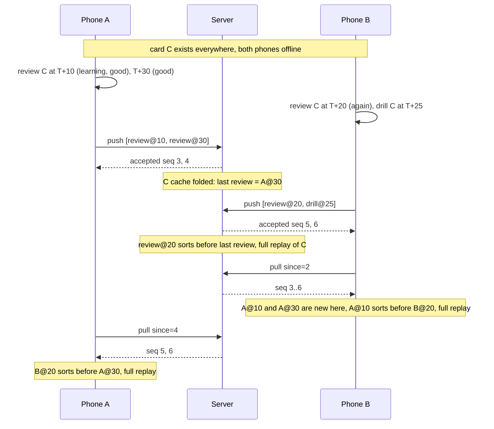
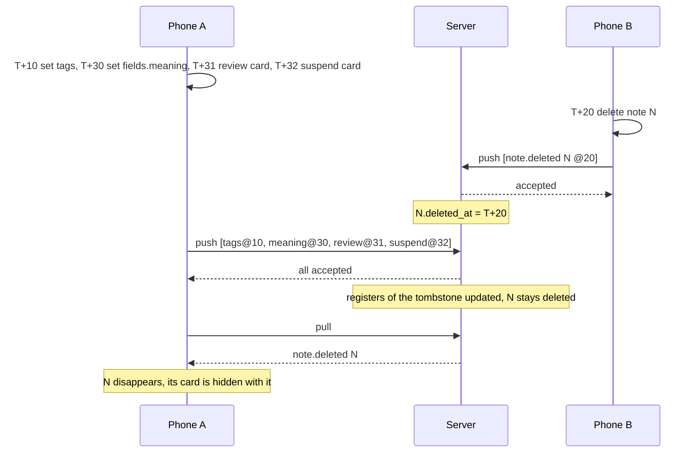
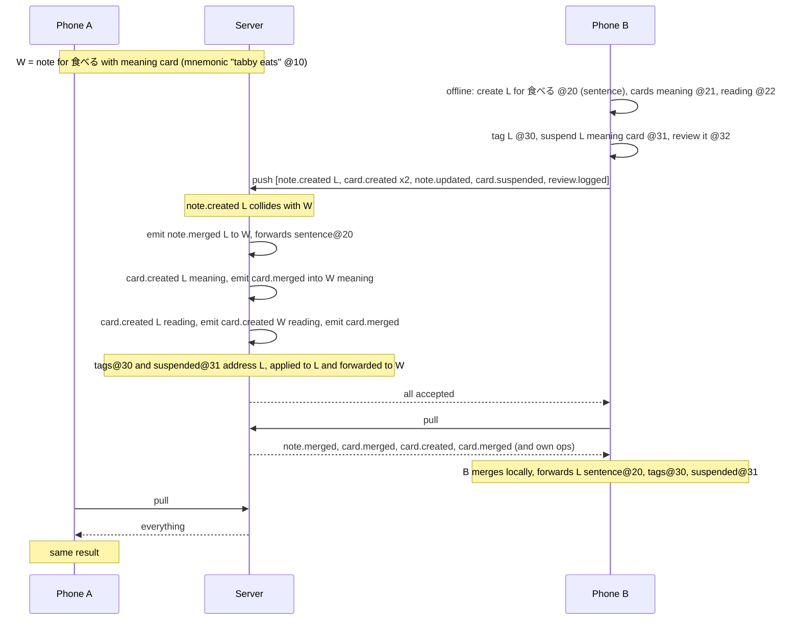
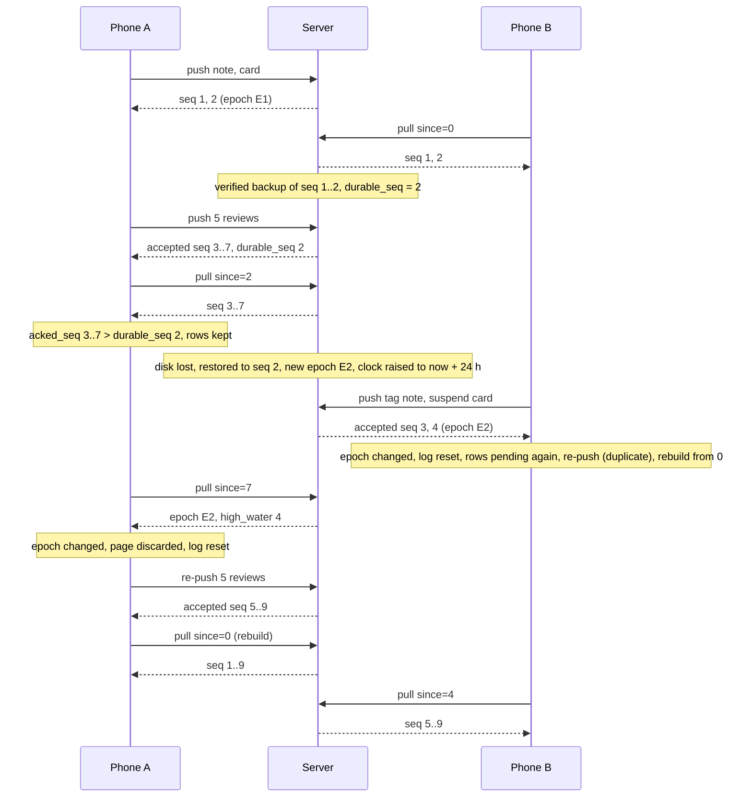

# Sync contract (T005)

Frozen interface between every replica of the learning data: the server (Postgres), the phone
(SQLite), the web app and scripts. Replicas exchange **operations**, never rows.

| File | What |
|---|---|
| `SYNC.md` | This document: protocol, clocks, apply rules, merging, replay, rejected ops, convergence, worked examples. |
| [`OPS.md`](OPS.md) | One section per op type: emitter, entity, server-side rejections, conflict rule, apply, replay, example. |
| `batch.schema.json` | **Entry point for the HTTP bodies** of `POST /sync/push` and `GET /sync/pull` (T004 references it). |
| `op.schema.json` | The op envelope; selects the payload schema by `op_type`. |
| `ops/<op_type>.schema.json` | Payload schema per op type (JSON Schema 2020-12). Every property has its definition there. |
| `ops/index.json` | Machine-readable registry: op type → entity type, `entity_id` derivation, emitter, whether devices apply it. |
| `common.schema.json` | Shared scalar types (uuid, hlc, instant, item key, …). |
| `scenario.schema.json`, `examples/scenarios/` | Machine-readable worked examples (section 13) for the convergence tests. |
| `examples/ops/`, `examples/batches/`, `examples/invalid/` | One or more examples per op, example HTTP bodies, and instances that must be rejected. |
| `tools/model.py`, `tools/validate.py`, `check.sh` | Reference model of a replica, the server (validation, merge verdicts, restore) and a device's sync procedure; the contract's self-check (section 16). Not normative. |
| `SUMMARY.md` | Decisions, rejected alternatives, things worth a second look. |

Depends on `contracts/db` (tables, registers, clocks, merge columns). Where this document and
`contracts/db/SCHEMA.md` describe the same thing, they agree; this document is the more detailed one
for everything that happens to an op. Implementers: if something you need is missing or wrong, do
not work around it — return `CONTRACT_CHANGE_REQUEST`.

The key words MUST, MUST NOT, SHOULD and MAY are used as in RFC 2119.

---

## 1. Model

- A **replica** holds the learning tables: the server, each paired phone, each web session that
  keeps local state. A client that only calls REST endpoints is not a replica; the server mints ops
  on its behalf.
- Every change to learning data is an **op** (section 2). A replica that makes a change *mints* an
  op, applies it to its own tables, and queues it. The server keeps every accepted op in the log
  (`app.change`) with a sequence number `seq`.
- Every replica applies ops with **the same apply function** (sections 7–9). Only the server
  additionally (a) validates and may reject pushed ops (section 5), and (b) detects duplicates and
  emits merge ops (section 8.1).
- The apply function is designed so that replicas which have applied the same set of ops hold the
  same data (section 11), in whatever order the ops reached them, with two documented exceptions
  that rely on the server's order (8.1 verdicts, 7.6).

Terms: **register** — one independently merged value (`contracts/db/SCHEMA.md` section 3).
**Live** — a row whose `deleted_at` is NULL (for a card as a queue item: also its note's).
**Tombstone** — a row with `deleted_at` set. **Loser / survivor** — the two rows of a merge.
**wall(h)** — the wall-clock part of HLC `h` as epoch milliseconds: `parseInt(h[0..12], 16)`.

## 2. The op envelope

Schema: [`op.schema.json`](op.schema.json). The same eight properties are the columns of
`pending_op` (device) and `change` (server).

| Property | Definition | Constraints | Example |
|---|---|---|---|
| `op_id` | Identity of the op; the idempotency key. | UUIDv7, lowercase, minted with the op. Unique forever. | `0193a1b2-00ff-7005-8000-000000000004` |
| `op_type` | What the op does. | One of the 45 names in `ops/index.json`. | `note.created` |
| `op_version` | Version of the payload schema for this `op_type`. | `1` for every op in this contract. | `1` |
| `entity_type` | Table the op targets. | Fixed per `op_type` (`ops/index.json`). | `note` |
| `entity_id` | Primary key of the targeted row, as text. | Derived from the payload: the properties listed in `ops/index.json` joined with `\|`. Must match the payload. | `0193a1b2-0001-7000-8000-000000000002` |
| `device_id` | The replica that minted the op. | Must equal the device part of `hlc`. | `01931f3e-0000-7000-8000-0000000000b2` |
| `hlc` | The op's clock (section 3). | 54 characters. | `0193a1b2c014-0000-01931f3e-0000-7000-8000-0000000000b2` |
| `payload` | Op-specific body. | Validates against `ops/<op_type>.schema.json`. Closed: unknown properties are invalid. | `{"id": "…", "note_type_id": "…"}` |
| `seq` | Server sequence number. | Only on ops that come *from* the server (pull). Absent on pushed ops. | `4` |
| `caused_by_op_id` | The op that made the server emit this one. | Only on pulled ops; `null` unless server-emitted as a consequence (merge, cascade). | `null` |

Rules for every payload:

- **Instants** are integers: milliseconds since the Unix epoch, UTC (`common.schema.json#/$defs/instant_ms`).
- **Ids** are canonical lowercase UUIDs. New rows get a UUIDv7 from whoever creates them.
- **Omitted optional properties** mean "the column default" in `*.created` ops. In `*.updated`
  ops only the registers named in `set` are written.
- **Nested JSON shapes** stored in a JSON column (field definitions, templates, deck settings,
  detection rules, links, tokens) are open: unknown keys inside them MUST be preserved.
- An op has **no wall-time property of its own**: its wall time is `wall(hlc)`. `created_at`,
  `updated_at`, `deleted_at`, `added_at`, `undone_at` are all derived from HLCs, which is why they
  are equal on every replica. Only `review.logged` carries a separate instant (`reviewed_at`).

Full example ([`examples/ops/note.created.json`](examples/ops/note.created.json)):

```json
{
  "op_id": "0193a1b2-00ff-7000-8000-000000000008",
  "op_type": "note.created",
  "op_version": 1,
  "entity_type": "note",
  "entity_id": "0193a1b2-0001-7000-8000-000000000001",
  "device_id": "01931f3e-0000-7000-8000-0000000000a1",
  "hlc": "0193a1b2c008-0000-01931f3e-0000-7000-8000-0000000000a1",
  "payload": {
    "id": "0193a1b2-0001-7000-8000-000000000001",
    "note_type_id": "00000000-0000-7000-8000-000000000101",
    "entry_seq": 1358280,
    "fields": { "sentence": "パンを食べる" },
    "tags": ["anime", "frieren"],
    "source_sentence": "パンを食べる",
    "source_sentence_id": "0193a1b2-0009-7000-8000-000000000001",
    "source_media_id": "0193a1b2-0007-7000-8000-000000000001",
    "origin": "reader"
  }
}
```

## 3. Hybrid logical clock

### 3.1 Format and comparison

```
0193a1b2c3d4-0001-01931f3e-0000-7000-8000-0000000000a1
└── ms ────┘ └ctr┘ └──────────── device uuid ─────────┘
 12 hex       4 hex   36 chars
```

- `ms`: milliseconds since the Unix epoch, 12 lowercase hex digits, zero-padded.
- `ctr`: counter, 4 lowercase hex digits (`0000`–`ffff`).
- device: the id of the replica that minted the value.

**Comparison is byte-wise string comparison** (`COLLATE "C"` in Postgres, `BINARY` in SQLite,
ordinary `<` on strings in Kotlin, JS and Python). It orders by `ms`, then `ctr`, then device id, and
is a total order. Two different ops never have equal HLCs (3.3), so "equal clock" always means
"the same op again".

### 3.2 Minting and observing

Each replica keeps `last = (ms, ctr)`, durably (`sync_state.hlc_last` holds the last full HLC string;
the server keeps its own in a place T-server chooses). `pt` is the physical clock in ms.

```
mint():                                   observe(h):            # h = any HLC seen in an op envelope
  if pt > last.ms:  last = (pt, 0)          if (h.ms, h.ctr) > (last.ms, last.ctr):
  else if last.ctr < 0xffff:                    last = (h.ms, h.ctr)
        last = (last.ms, last.ctr + 1)
  else: last = (last.ms + 1, 0)
  return format(last, own device id)
```

- A replica MUST call `observe` for the envelope `hlc` of **every op it applies** that it did not
  mint (device: every pulled op; server: every accepted pushed op), before it mints again. So a
  replica's next HLC is greater than everything it has seen, and a change made *after* seeing
  another change always wins against it.
- `replay_hlc` inside a `review.logged` payload is data, not a clock event: it is never observed.
- `last` MUST be persisted in the same transaction as the op that was minted or applied.
- The first HLC of a new replica: `last = (0, 0)` before the first mint.
- `last` never goes backwards. The only two places where it is *set* rather than advanced are
  the server's restore procedure (6.2, where it is raised) and the device's clock recovery (10.4,
  where it is lowered under conditions that keep every HLC unique).

### 3.3 Uniqueness invariants

- An HLC with device part `D` is only ever minted by replica `D` from its own `last`. The server
  never mints on behalf of another device id: ops it creates for REST callers carry the server
  device id `00000000-0000-7000-8000-000000000001` (and the caller's token in `change.token_id`).
- A device id MUST NOT be reused after its local database is lost or restored from a backup
  (`last` would go backwards and HLCs could repeat). Re-pair to get a new device id.
- Per device, HLCs are strictly increasing in mint order, so "ascending hlc" = "the order in
  which the device made its changes".

### 3.4 Clock skew and the clock bounds

- A replica whose physical clock is behind still mints increasing HLCs (it keeps counting on `last`).
- A replica whose physical clock is **ahead** mints HLCs in the future. Its writes win
  last-writer-wins comparisons against writes other replicas make before they have seen them.
  Once an op with a future HLC has been observed, every replica mints above it. Wall times derived
  from HLCs (`created_at`, `updated_at`) are then ahead of real time until real time catches up.
- To bound that damage, the server **rejects** a pushed op (5.3), comparing with `now` = the
  server's wall clock when it validates the op:

  | Code | Condition |
  |---|---|
  | `clock_ahead` | `wall(hlc) > now + 24 h + ε`; or, for `review.logged`, `reviewed_at > now + 24 h`. |
  | `clock_behind` | `wall(hlc) < FLOOR`; or, for `review.logged`, `reviewed_at < FLOOR`. |

  `FLOOR` = `1577836800000` (2020-01-01T00:00:00Z). The 24 h tolerance is `86400000` ms; it
  absorbs ordinary skew and time-zone mistakes, so a correct phone never meets these codes.
  `ε` = `60000` ms (60 s) applies to the HLC comparison only: after a restore (6.2) the server's
  clock sits at `now + 24 h`, a device that pulled a server op minted then mints just above it
  (counter overflow can add milliseconds), and without the slack its next push could be refused
  by a few milliseconds. Ops the server mints itself (REST, jobs, imports with `import_source`)
  are not checked: imported history is legitimately older than its card.
- **There is no card-age check.** Attempt 2 also refused a review dated more than 24 h before its
  card's `created_at`. That was not robust: `created_at` comes from the creating device's clock,
  which may itself be up to 24 h ahead, so a phone 2 h behind could be refused for reviewing a card
  made by a phone 23 h ahead — both within tolerance. The same bound is now kept on the device,
  where it is exact (guard G2 below: a device has observed the card's `card.created` HLC before it
  can review the card, so G2 implies `reviewed_at >= card.created_at − 24 h`), and re-mint (10.4)
  clamps re-minted reviews to the card's creation. The server accepts a review dated before its
  card; replay is unaffected beyond the clamp of 9.3.
- Consequences: no op in the log has an HLC more than 24 h + ε ahead of the server's clock at the
  time it was accepted, so a wrong date can make edits win for at most a day; and replay never sees
  a `reviewed_at` decades off (a phone reset to 1970 would otherwise produce a 56-year interval).
- Everything else is still tolerated: old HLCs, ops addressed to tombstones, `reviewed_at`
  disagreeing with HLC order (replay clamps negative elapsed time to 0, section 9.3).
- **Client duties.** `PushResponse.server_time` and `PullResponse.server_time` let a client compare:
  if `|server_time − pt| > 5 minutes` it MUST show a clock warning in its sync status; if
  `|server_time − pt| > 24 h` it MUST also stop minting (reviewing and editing are blocked with a
  "your device clock is wrong" status) until a later response shows the difference below 5 minutes.
  A rejection with a clock code is handled as in 10.4.
- **Device-local guard (no protocol change).** Before every mint (section 4) — and on app start and
  before a review session begins, so the user is told before answering anything — a device checks
  its physical clock against what it already knows, offline:

  | Guard | Refuse to mint when |
  |---|---|
  | G1 | `pt < FLOOR` (a clock reset to 1970 or 2000) |
  | G2 | `pt < wall(hlc_last) − 24 h` (the clock is far behind a time this device has already minted or observed) |

  While either holds, reviewing and editing are blocked with a "fix your device clock" status (an
  i18n string); nothing is minted, so nothing can be lost. The block lifts as soon as neither
  holds; no server contact is needed. G2 can also block a device that is only slightly behind if
  it has observed an op from a device near the +24 h limit (the two skews add up to more than a
  day); that device is behind and is told so, which is right. A clock that is *ahead* is not
  detectable offline; it is caught by the server (`clock_ahead`) and handled by re-mint (10.4).

## 4. Making a change on a device

In **one local transaction**:

1. `h = mint()`; build the op (`device_id` = own id, new UUIDv7 `op_id`).
2. Apply it with the local apply function (sections 7–9) — exactly the code path used for pulled ops.
3. Insert the `pending_op` row (`state = 'pending'`, `created_at` = now).
4. Persist `hlc_last`.

A device MUST NOT mint while `sync_state.rebuild_pending` is set (10.3), while its clock is
known to be more than 24 h off the server's, or while guard G1 or G2 holds (3.4).

Client duties before minting (the server will reject otherwise, section 5.3):

- Mint the ops for a new row before any op that references it (they then sort first by HLC).
- A client MUST NOT knowingly create a duplicate: before creating a vocab / kanji / grammar note
  it looks for a live local note with the same `entry_seq` / `kanji_literal` /
  `grammar_point_id` and uses that; before creating a card it looks for a live card of that
  `(note, kind)`. Duplicates therefore only arise between replicas that had not yet synced, and
  those are merged by the server (section 8).
- A new note's cards are separate `card.created` ops minted by the client right after
  `note.created`: one per template with `default = true`, unless the deck setting `card_kinds`
  says otherwise. A note with no cards is legal.
- One row per op: bulk actions mint one op per card.

A device works on **survivors**: once it has applied a merge, its UI addresses the survivor. Ops
still in its outbox that address the loser are pushed unchanged.

## 5. Push

`POST /sync/push` — body [`batch.schema.json#/$defs/PushRequest`](batch.schema.json), response
`#/$defs/PushResponse`. HTTP status codes, auth and scopes are T004's.

### 5.1 Request

- `ops`: 1–500 ops, all minted by the pushing device, in strictly ascending `hlc`.
- A device pushes its `pending_op` rows with `state = 'pending'` in ascending `hlc`, 500 at a
  time, until none are left. It never pushes ops minted by anyone else.
- Example: [`examples/batches/push-request.json`](examples/batches/push-request.json).

### 5.2 Server procedure

The server validates the body against `#/$defs/PushRequestLenient` **only** (a JSON object with
`ops`: 1–500 objects each having a UUID `op_id`) and may fail the **whole request** (HTTP 400, T004)
only if that fails. It never validates the body against `#/$defs/PushRequest`: that would turn one
op of an unknown type or a malformed op into a 400 for the whole outbox. Everything else is decided
**per op**, in array order, so one bad op never blocks the outbox.

For each op, **in one transaction that takes advisory lock `7033001` before step 1** (the lock is
held until commit):

1. **Duplicate?** If `op_id` is already in `change`: result `duplicate` with the original `seq`.
   Nothing else is looked at (not even whether the content is the same). This check MUST run
   under the lock: otherwise the same op pushed twice concurrently (a retry racing a slow first
   attempt) passes the check twice and the second insert fails on `change.op_id UNIQUE`.
2. **Validate** (section 5.3). On failure: result `rejected`; no table is touched, no `change` row.
3. **Apply:** `observe(op.hlc)`; apply the op (sections 7–9); insert the `change` row; then run
   collision detection (section 8.1), which may mint, apply and log further ops with
   `caused_by_op_id = op.op_id` — in the same transaction, with consecutive `seq`.
4. Commit. Result `accepted` with the op's `seq`.

An accepted op may have **no effect** (it lost a clock comparison, or the row/review id already
existed). It is still logged, still gets a `seq`, and is still delivered to every replica.

A rejected op does not stop the batch. Ops that depended on it are validated on their own and
will usually be rejected too (`unknown_reference`).

The server MAY process a batch in one transaction holding the lock throughout, with a savepoint
per op, or one transaction per op; the results must be the same. If the response is lost the client pushes the same ops again and
gets `duplicate` for those that were committed.

### 5.3 Validation and rejection codes

Checked in this order; the first failure decides the code.

| Code | Meaning | Checked for |
|---|---|---|
| `unsupported_op` | `op_type` or `op_version` unknown to this server. | every op |
| `schema_invalid` | The op does not match `op.schema.json`; or `entity_type` / `entity_id` do not match the payload (`ops/index.json`); or `device_id` is not the device part of `hlc`. | every op |
| `device_mismatch` | `device_id` is not the device the caller is authenticated as. | every op |
| `server_only` | A server-emitted op type, or a server-only variant (`deck.created` with type media/list; `review.logged` with `import_source`/`replay_hlc`; `word.status_set` with origin `jpdb_import`; `device_id` = the server device). | see `ops/index.json` and OPS.md |
| `unknown_reference` | A row the op needs does not exist on the server (the target of an update/delete, a card's note, a review's card, …). Tombstoned rows *do* exist. | per op, OPS.md |
| `clock_ahead` | `wall(hlc)` is more than 24 h + 60 s, or a review's `reviewed_at` more than 24 h, after the server's clock. | every op; `review.logged` (3.4) |
| `clock_behind` | `wall(hlc)`, or a review's `reviewed_at`, before 2020-01-01. | every op; `review.logged` (3.4) |
| `invalid_value` | A cross-field or cross-row rule is violated (e.g. `entry_seq` on a kanji note). | per op, OPS.md |
| `invalid_target` | The target exists but this op may not address it (item ops on a media deck, client `deck.deleted` on a media deck). | per op, OPS.md |
| `immutable` | Attempt to delete or cripple a built-in (note types, the Default preset). | per op, OPS.md |

- The set is open: a client MUST treat an unknown code as a permanent rejection.
- `error.message` is an English diagnostic; clients show it but never parse it.
- Soft references (`entry_seq`, `sentence_id`, `source_*_id`, `media_id` on spans and overrides,
  `related_ids`) are **never** validated.
- Apart from the two clock codes (3.4), the server never rejects because of what a clock says:
  old HLCs, HLCs up to 24 h ahead and ops addressed to tombstones are all accepted.
- Example with every code: [`examples/batches/push-response.rejected.json`](examples/batches/push-response.rejected.json),
  scenario [`rejected-ops`](examples/scenarios/rejected-ops.json).

### 5.4 Response and what the client does with it

`results` has exactly one entry per pushed op, in request order.

| `status` | Client action on the `pending_op` row |
|---|---|
| `accepted`, `duplicate` | `state = 'acked'`, `acked_seq = seq`; `sync_state.hlc_acked = max(hlc_acked, op.hlc)` in the same transaction. |
| `rejected` | `state = 'rejected'`, `last_error = "<code>: <message>"`. The local effect stays. See section 10. |

- No response, a 5xx or a 429: rows stay `pending`, `attempts += 1`, retry with exponential
  backoff (5 s doubling to a cap of 15 min, reset on success).
- A 400 for the whole request means a client bug: rows stay `pending`, the error is shown in the
  sync status, retried with the same backoff.
- A 401/403: stop syncing and ask the user to re-pair / log in. Rows stay `pending`.
- An `acked` row may be deleted only once **`acked_seq <= pull_seq` and `acked_seq <= durable_seq`**
  (the latest `durable_seq` of the current `log_epoch`, 6.2). Until a verified backup covers it, the
  device's copy is the only one that survives a restore of the server.
  (This narrows `contracts/db/SCHEMA.md` 5.3, which only says "may be purged once
  `pull_seq >= acked_seq`".)
- Before acting on the results, compare `log_epoch` and `high_water_seq` with the stored state as
  in 6.2. If the log changed, the results are still recorded (they are valid in the new log), and
  then the log reset of 6.2 starts.
- Otherwise `high_water_seq` is informational ("n changes to download"); store `durable_seq`.

## 6. Pull

### 6.1 Pulling

`GET /sync/pull?since=<seq>` — response [`batch.schema.json#/$defs/PullResponse`](batch.schema.json).
A client validates the body against `#/$defs/PullResponseLenient` (open `op_type` / `op_version`)
and each op against `op.schema.json` only if it supports that type and version; validating the whole
body against `PullResponse` would make an old client reject the page instead of applying the ops
before the first unknown one.

- The server returns `change` rows with `seq > since` in ascending `seq`, at most 1000 (the page
  size and a `limit` parameter are T004's; recommended default 500), from **every** origin,
  including ops the requester pushed itself and ops that had no effect.
- `next_since` = `seq` of the last op returned, or `since` if none. `has_more` = more rows exist.
- Because of the advisory lock, no row with a smaller `seq` can appear after a row was returned.
  `seq` may have gaps.
- A new device starts at `since = 0` and receives the whole history (the log is never pruned in v1).
- Examples: [`pull-response.json`](examples/batches/pull-response.json),
  [`pull-response.empty.json`](examples/batches/pull-response.empty.json).

**Client procedure**, one local transaction per page:

0. Compare `log_epoch` / `high_water_seq` with the stored state (6.2). If the log changed, discard
   the page (apply nothing) and start the log reset.
1. For each op in order: `observe(op.hlc)`; apply it (sections 7–9). Ops with
   `device_applies = false` in `ops/index.json` are skipped (cursor still advances).
2. Set `sync_state.pull_seq = next_since`, `durable_seq`; persist `hlc_last`.
3. Commit; if `has_more`, pull again.

- **Own ops come back** in the pull. The device applies them like any other op; they are no-ops
  because of the idempotency rules (7.8). There is deliberately no "skip my own ops" rule.
- **Unknown `op_type`, or `op_version` higher than the client supports:** apply the ops before
  it, set `pull_seq` to the `seq` just before it, commit, and stop pulling. The client is in state
  *upgrade required*: it MUST say so in its sync status, MUST NOT skip the op, keeps working
  offline and keeps pushing. After an app update the pull resumes at the same op.
- **An op whose target row is missing** (cannot happen in `seq` order): no-op, logged as a
  diagnostic; the cursor advances.
- A device never validates or rejects pulled ops.

**Sync cycle:** push until the outbox has no `pending` rows; if `rebuild_pending` is set, run the
rebuild (10.3); otherwise pull until `has_more` is false; then delete the `acked` rows allowed by
5.4 and set `last_sync_at`. Run on app open, after a review session, and in the background while the
server is reachable.

### 6.2 Log identity: backups and restores

A server restored from a backup has lost the tail of its log, and its `seq` restarts below values
devices have already seen. Without detection a device that pulled up to `seq` 150 asks for
`since=150`, gets nothing, and never sees the new ops 101–120; and if devices had already purged
their acked ops, the ops 101–150 are gone everywhere. Two values in every `PushResponse` and
`PullResponse` prevent this:

| Property | Definition |
|---|---|
| `log_epoch` | UUID naming the log. Created with the database; replaced by a new UUIDv7 on **every restore** (and on any other event that can make `seq` values repeat or disappear). Never reused. |
| `durable_seq` | Highest `seq` *s* such that every `change` row with `seq <= s` is in a **verified** backup that any future restore will start from. `0 <= durable_seq <= high_water_seq`; never decreases within an epoch. Set by the backup job after verifying a backup (T-deploy/T-server choose where it is stored). A server configured with no backups reports `durable_seq = high_water_seq` (there is nothing it could be restored from). |

**Server, on restore** (T-server implements, T-deploy's restore script triggers):

1. Restore the newest verified backup. Restoring an older one loses ops that devices have
   already purged (they trusted the newer `durable_seq`); the restore tool MUST warn and require
   confirmation.
2. In the restored database, before serving any request: new `log_epoch`; `durable_seq` = the
   highest `seq` in the restored `change` (that backup is verified).
3. **Clock:** set `last` = the greatest of the restored `last`, every `change.hlc` in the restored
   log, and `(now + 24 h, 0)` — unless T-server keeps a copy of `last` outside the database that
   is known to be at least as new as the lost state, in which case that copy replaces the third
   term. Every op accepted before the loss had `wall(hlc) <= its receive time + 24 h` (3.4) and
   every op the server minted was at most one tick above those or its own clock, so this bound is
   above every HLC the lost log contained: the server's clock never goes backwards and never
   reissues a lost server HLC. Side effect: until real time catches up (at most 24 h), rows the
   server creates or updates get `created_at` / `updated_at` (= `wall(hlc)`, 7.5) up to 24 h ahead
   of real time, and so do rows devices write after observing those ops.
4. Server-emitted ops that were lost are re-derived where possible: merges are re-emitted when
   the devices push their ops again (8.1). Ops minted for REST callers or jobs since the backup
   (REST edits, `media.created`, `*.published`, suggestions) are lost; jobs SHOULD be re-run.

**Device, on every response** (push or pull), compare before using it:

- No `sync_state.log_epoch` stored yet (new device, or an app that predates this key): store
  the response's value; no reset.
- The response's `log_epoch` differs from the stored one, **or** `high_water_seq < pull_seq`
  (a log that went backwards without an epoch change; treat it the same):
  **log reset**.

**Log reset.** In one local transaction: every `pending_op` row in state `acked` becomes
`pending` (`acked_seq = NULL`, `attempts = 0`); store the new `log_epoch` and `durable_seq`; set
`rebuild_pending = "1"`. Then the sync cycle continues as usual: it pushes every pending row
(the server answers `duplicate` for ops the backup contained and `accepted` with a new `seq` for
ops it lost) and runs the rebuild (10.3), which wipes everything the device had pulled from the
lost log and pulls the new one from 0. The procedure is restartable at any point.

- Ops re-pushed by one device can be rejected with `unknown_reference` if they depend on a lost
  op of another device that has not re-pushed yet (a review of a card another phone created).
  **Auto-retry:** after a log reset the device sets every row in state `rejected` with code
  `unknown_reference` back to `pending` at the end of each later sync cycle whose pull advanced
  `pull_seq` (the other device's re-pushed ops arrived), until it is accepted or has been
  auto-retried 10 times since the reset (counted in `attempts`, which the reset sets to 0 for these
  rows too); after that it is an ordinary rejected op (section 10) for the user. Re-pushing an op
  whose reference is really missing only gets it rejected again.
- A device's ops that were in the lost tail and are no longer in its outbox cannot be recovered;
  with the rule of 5.4 this happens only if an older backup than the newest verified one was restored.
- Worked example: 12.5.


## 7. Applying an op

The rules of this section are the same on every replica. Per-op details are in OPS.md.

### 7.1 The clock rule (registers)

To write value `v` to register `r` of a row at clock `h`:

> if `r` has no stored clock, or `h` > the stored clock: store `v`, store `h` as the clock of `r`,
> and set `updated_at = max(updated_at, wall(h))`. Otherwise do nothing.

- Tables with a `clocks` column store `{register: hlc}`; register names are listed in each
  table's `clocks` column comment in `V1__init.sql` and in OPS.md. `fields.<key>`,
  `settings.<key>` and `templates.<kind>` address one key of a JSON object column.
- A `*.updated` op writes each register named in its `set`, all at the op's `hlc`, each compared
  on its own. Part of an op may win while another part loses.
- A register that has **no clock** holds its creation default and loses to every op.
- Removing a key (`settings.<key>` or `templates.<kind>` set to `null`) removes it from the object
  but keeps the register's clock, so an older write cannot bring it back.
- Example and proof by enumeration: scenario [`note-fields-lww`](examples/scenarios/note-fields-lww.json).

### 7.2 The creation rule

A `*.created` op with clock `h`:

- If a row with that id exists: **no-op** (whatever the row holds).
- Otherwise insert the row with `created_at = updated_at = wall(h)`, `deleted_at = NULL`, and
  stamp `clocks[r] = h` for every register whose initial value **differs from the column
  default** (JSON equality; a property omitted from the payload *is* the default). Columns without
  a default (`name`, `title`, `kind`, `fields` of a note type) are always stamped.
- For JSON-object columns (`note.fields`, `deck.settings`, `note_type.templates`): a key whose
  value is `null`, `""`, `[]` or `{}` is **dropped** (not stored, no clock); every other key is
  stored and stamped `clocks["<column>.<key>"] = h`.

So a creation value competes like any other write, and an untouched default never overwrites
anything. The exact stamping per op is listed in OPS.md.

### 7.3 Tombstones

- `*.deleted` writes the register `deleted` by the clock rule; the row's `deleted_at` is
  `wall` of the winning (highest) delete clock.
- **Deletion is permanent.** No op clears `deleted_at`. Ops addressed to a tombstone are accepted
  and their register writes are applied by the clock rule (so all replicas hold the same row);
  the row stays deleted. Consequently a delete beats every edit, **older or newer**
  (scenario [`edit-vs-delete`](examples/scenarios/edit-vs-delete.json)).
- Exceptions, where removal is an ordinary reversible value: `deck_item` and manual
  `sentence_grammar_span` rows (7.4).
- Children are not tombstoned with their parent: a deleted note's cards, a deleted deck's items
  and a deleted card's reviews keep their rows. Readers hide them by filtering on the parent.
- Ops that reference a tombstoned **parent** are accepted: `card.created` for a deleted note,
  `review.logged` for a deleted card, `deck.item_put` into a deleted deck, `note.created` with a
  deleted note type. The new rows exist and are hidden.

### 7.4 Whole-row values

`settings`, `word_status` (override columns), `deck_item`, manual `sentence_grammar_span`,
`confusable` and `parse_override` have one clock column for the whole row. The op is applied iff
no row exists or its `hlc` is greater than the stored one (`confusable` compares rank first, see
OPS.md); when it is applied **it determines every op-written column of the row**, including
`added_at` / `created_at` / `deleted_at`, exactly as listed in OPS.md. A `*_removed` op for a row
that does not exist inserts the tombstone row, so an older `*_put` arriving later loses
(scenario [`deck-item-put-remove`](examples/scenarios/deck-item-put-remove.json)).

### 7.5 Timestamps

| Column | Value |
|---|---|
| `created_at` (tables with `clocks`) | `wall(h)` of the creating op. Built-in rows: epoch 0. |
| `updated_at` (tables with `clocks`) | max of `created_at`, `wall` of every register write that won on the row (for a forwarded write: the original op's clock), and `wall` of a merge op that tombstoned it or a `*.published` op applied to it. |
| `deleted_at` | `wall` of the winning delete; for a merge loser with no delete op: `wall` of the merge op (8.2). |
| whole-row tables | see OPS.md per op. |
| `word_status.updated_at` | `max(updated_at, wall(h))` when an override op wins; local "now" when `auto_status` is re-derived. **Not** comparable between replicas. |

### 7.6 Values only the server writes

`deck.content_published`, `media.content_published` and `fsrs_params.published` carry a version
number assigned by the server; the higher version wins (OPS.md). They are emitted by one
replica and delivered to all others in `seq` order.

`media.content_published` may repeat a `content_version` with a different `parse_status`
(parsed → parsing → failed). It is applied iff its version is **>=** the stored one, so it is the
one op that relies on being applied in `seq` order; replicas always receive it that way.

Snapshots (the `deck_item` rows of media/list decks; a media's segments, sentences, occurrences
and detected spans) are not ops. A `*.content_published` op only announces a version and a blob
hash; a device installs the blob whenever it likes, replacing the rows in one transaction and
recording `installed_content_version`. The blob formats are not part of this contract.

### 7.7 Missing targets

On the **server**, an op whose target or required parent does not exist is rejected
(`unknown_reference`) and never enters the log. On a **device**, a pulled op whose target is
missing is a no-op (it cannot happen in `seq` order; it can happen during the re-apply step of a
rebuild, section 10.3).

### 7.8 Idempotency

- The server applies each `op_id` at most once (`change.op_id` is unique).
- Independently of that, **applying an op to a replica that has already applied it changes
  nothing**: creation of an existing id is a no-op; a register write with an equal clock is not
  greater; a review with an existing id is not inserted again; an undo with an equal clock is not
  smaller; a merge whose loser is already merged is a no-op; a version that is not higher is
  ignored. (Exception: `media.content_published`, 7.6, is idempotent only in `seq` order.)
- Replaying the entire log from `seq` 0 onto an up-to-date replica changes nothing.
- A device therefore needs no "have I seen this op" table.

### 7.9 `review_log` is append-only — the device rules

Postgres enforces this with a trigger; on a device the apply code MUST enforce exactly:

1. `review.logged`: `INSERT` if no row with that `id` exists; otherwise do nothing, even if the
   payload differs from the stored row.
2. No statement ever changes any column of an existing row other than `undone_at` and `undone_hlc`.
3. `review.undone` with clock `h`: apply **iff `undone_hlc IS NULL OR h < undone_hlc`**; then set
   `undone_hlc = h`, `undone_at = wall(h)` in one statement. Otherwise do nothing. So the
   *earliest* undo is recorded whatever the arrival order
   (scenario [`undo-on-two-devices`](examples/scenarios/undo-on-two-devices.json)).
4. `undone_at` / `undone_hlc` are never set back to NULL and never raised.
5. No `DELETE`, with one exception: the full wipe at the start of a rebuild (section 10.3).
6. A review is undone by minting `review.undone`, never by deleting. An undo cannot be undone:
   the client logs a new review instead.

Tests for T006/T107: duplicate insert with different content keeps the first; undo A(h=20) then
B(h=15) → 15; B then A → 15; same undo twice → unchanged; undo for an unknown id → no row, no error.

## 8. Duplicates and merging

"Words are learned once": at most one live note per `entry_seq`, per `kanji_literal`, per
`grammar_point_id`; at most one live card per `(note_id, kind)`. Two replicas can each create one
while offline. **The server decides** which row survives and says so with `note.merged` /
`card.merged`; **every replica then performs the merge itself** from its own rows. No merged
values travel in the op.

### 8.1 Trigger (server only)

After applying any accepted op, in the same transaction:

**Note collision.** The op was `note.created`, or a `note.updated` that **won** the `entry_seq`
register, its note N is live, and another live note W holds the same non-null `entry_seq` /
`kanji_literal` / `grammar_point_id`. Then N is the **loser** and W the **survivor** — always the
note that already held the reference, regardless of ids and clocks. The server emits, in this order:

1. `note.merged {loser_id: N, survivor_id: W}`;
2. for each card c of N with `deleted_at IS NULL` and `merged_into_id IS NULL`, ordered by
   `(kind, id)`: if W has no live card of `c.kind`, a `card.created {id: <new UUIDv7>, note_id: W,
   kind: c.kind}` (no other properties, so no clocks); then `card.merged {loser_id: c,
   survivor_id: W's live card of that kind}`. Cards of N that are already tombstoned are left alone.

**Card created on a merged note.** The op was `card.created` for a note N with `merged_into_id = W`:
the new card is applied to N as usual, then merged as in step 2.

**Card collision.** The op was `card.created` for a note that already has another live card of
the same `kind`: the new card is the loser; the server emits `card.merged {loser_id: new,
survivor_id: existing}`.

For cards, "live" means the card's own `deleted_at IS NULL` (the note may be tombstoned).

- Emitted ops are minted with the server's clock *after* observing the triggering op (so their
  HLC is greater), carry `device_id` = the server device and `caused_by_op_id` = the triggering
  op, are applied by the same apply function, and get the next `seq` values.
- The triggering op itself is **applied to N in full first** and is `accepted`. The unique
  indexes are a safety net and must never reject an op (on Postgres the write that creates the
  collision and the tombstoning of the loser must be one statement; see `contracts/db/test/smoke.sql`).
- No collision, no merge: if N is already tombstoned, or the `entry_seq` write lost the register,
  or W is tombstoned, nothing is emitted.
- `media` and `list` decks have natural keys but no merge rule; they are created only by the
  server (OPS.md, `deck.created`).

### 8.2 Applying `note.merged` / `card.merged` (every replica)

Given loser L and survivor W (if W itself has `merged_into_id`, use that row instead; if L
already has `merged_into_id`, the op is a no-op):

1. **Forward registers.** For every register `r` that has a clock in `L.clocks`, except
   `deleted` (and, for notes, `entry_seq`): write `(L's current value of r, L.clocks[r])` to W by
   the clock rule. Registers of L without a clock are not forwarded.
2. **Tombstone L.** If `L.deleted_at IS NULL`, set it to `wall(merge op hlc)`. If it is already
   set, **leave it**. Never write `clocks.deleted` here. Set `L.merged_into_id = W`,
   `L.updated_at = max(L.updated_at, wall(merge op hlc))`.
3. **Flatten.** Every row whose `merged_into_id` is L gets `merged_into_id = W`. A
   `merged_into_id` never points at a row that itself has one.
4. `card.merged` only: replay W (section 9); L's cache columns are no longer maintained.

`L.deleted_at` is order-independent: a `note.deleted` / `card.deleted` addressed to L writes the
`deleted` register by the clock rule whenever it arrives (before the merge: the merge then leaves
`deleted_at` alone; after the merge: the register has no clock yet, so the delete wins and
overwrites the merge's value). Result on every replica: `wall` of the highest delete clock if any
delete op exists for L, else `wall` of the merge op
(scenario [`duplicate-deleted-before-push`](examples/scenarios/duplicate-deleted-before-push.json)).

### 8.3 After the merge (every replica)

Any op that writes a register of a row whose `merged_into_id` is set is applied **twice**: to the
addressed row, and — except `deleted` and `entry_seq` — to the row `merged_into_id` points at,
each by the clock rule with the op's own value and clock. This covers `note.updated`,
`card.suspended`, `card.unsuspended`, `card.buried`, `card.unburied`, `card.flag_set`,
`card.preset_set`.

- `note.deleted` / `card.deleted` addressed to a loser affect only the loser.
- `review.logged` for a loser card is inserted with the loser's `card_id`; it belongs to the
  survivor's replay set (9.1).
- Merges are permanent. Changing a loser's `entry_seq` afterwards does not un-merge it and is not
  forwarded.

*Why this converges.* The survivor's register `r` ends up holding the write with the highest
clock among all writes ever addressed to the survivor or any of its losers: a replica that
applied a loser's write before the merge forwards it in step 1; one that applies it after the
merge forwards it by 8.3; the clock rule makes both orders and any repetition give the same result.

### 8.4 Accepted trade-offs (stated, not fixed)

1. **A merge triggered by an `entry_seq` write stays, even if that write later loses.** If A
   re-matches note X onto W's entry at clock 10 and B re-matches X elsewhere at clock 20, the
   outcome depends on which op the server sees first: A first → X is merged into W, permanently,
   and B's newer value only changes the tombstone; B first → A's write loses the register, there is
   no collision and X stays live. Scenarios
   [`rematch-arrival-order-a`](examples/scenarios/rematch-arrival-order-a.json) and
   [`-b`](examples/scenarios/rematch-arrival-order-b.json). All replicas converge either way,
   because the verdict is in the log.
2. **A delete racing a duplicate depends on arrival order too.** If A deletes W while B creates
   a duplicate L: A's delete first → W is not live, L does not collide and lives on; B's create
   first → L is merged into W, then W is deleted, and the word is gone on both.
3. **A concurrent `note.deleted` on the survivor hides the duplicate's cards.** In the second
   case above, the cards B just created (now merged into W's cards) disappear from B's queue. B's
   reviews stay in `review_log`. Scenario
   [`survivor-deleted-concurrently`](examples/scenarios/survivor-deleted-concurrently.json).
4. **A duplicate's filled-in values reach the survivor even if the duplicate was deleted before
   it was ever pushed.** Ops arrive in HLC order: `note.created L` (merged, values forwarded),
   then `note.deleted L` (affects only L). Scenario
   [`duplicate-deleted-before-push`](examples/scenarios/duplicate-deleted-before-push.json).
5. **A duplicate's value can replace the survivor's** if its clock is newer (it is an ordinary
   write). Values left empty in the duplicate never do.
6. **A merge can add a card kind to the survivor** that the user had deleted there (8.1 step 2
   creates a missing live card).

### 8.5 References to a loser are resolved by readers, never rewritten

Rows that reference a note or card keep the id they were written with: `card.note_id`,
`review_log.card_id`, `deck_item.item_key` / `note_id`, `confusable.note_a_id` / `note_b_id`.
Readers resolve through `merged_into_id` (one hop; it is never a chain):

- **Reviews:** section 9.1.
- **Deck items:** an item `n:<id>` whose note has `merged_into_id = W` means W. The *effective
  identity* of an item is `e:<seq>` if its key is `e:<seq>` or its resolved note has a non-null
  `entry_seq`, else `n:<resolved note id>`. If several live items of one deck have the same
  effective identity they are **one** item: the one with the smallest `(position, item_key)`;
  the others are ignored. An item whose resolved note is tombstoned is hidden.
- **Removing such an item** (the user removes what the UI shows as one item): the client MUST mint
  `deck.item_removed` for **every** live key of that deck with the same effective identity, as
  resolved locally, in one transaction. Removing only the displayed key would let the next one
  surface as if the removal had not happened. A key that only becomes equivalent later (a merge
  that arrives after the removal) is not covered and the item reappears; the user removes it
  again. Re-adding uses one `deck.item_put` on the canonical key (`e:<seq>` if the note has an entry).
- **Confusables:** both ids are resolved. Rows that resolve to the same unordered pair and
  reason are one pair whose status is that of the row with the highest `(rank, hlc)`; a row whose
  two ids resolve to the same note is ignored; a pair with a tombstoned resolved note is hidden.
- Scenario [`duplicate-kanji-deck-item-confusable`](examples/scenarios/duplicate-kanji-deck-item-confusable.json).

### 8.6 On the device that created the duplicate

Between applying `note.merged` and receiving the `card.merged` ops, the loser's cards are hidden
(their note is a tombstone) and not yet part of any survivor. This window is normally a single
pull page. Nothing is lost: the reviews are in `review_log` and join the survivor's replay set
when `card.merged` is applied.

## 9. Replay

`card.state`, `step`, `stability`, `difficulty`, `due_at`, `interval_days`, `last_review_at`,
`last_review_id`, `reps`, `lapses`, `weights_version` are a **cache**. They never travel in ops.

### 9.1 Replay set

The reviews that determine card C's cache are all `review_log` rows with

- `card_id = C` **or** `card_id` = a card whose `merged_into_id = C`,
- `undone_at IS NULL`,
- `review_type IN ('scheduled', 'learning', 'manual')`,

ordered by `(review_log.hlc, review_log.id)`. `drill` and `cram` rows are never in a replay set.
The **effective preset** of C is the row `C.preset_id` points at, or the Default preset if that
row is tombstoned.

### 9.2 What forces a replay

"Target" = the card the op addresses, or its survivor if it has `merged_into_id`.

| Event (the op was applied, not merely received) | Cards | Kind |
|---|---|---|
| `review.logged` (schedule-feeding type) that sorts **after** the target's last folded review (or the target has none), **and** the target's cache is current: `card.weights_version` = the effective preset's `weights_version` | target | incremental fold |
| `review.logged` (schedule-feeding type) that sorts **before** the target's `last_review_id` row in `(hlc, id)` order — out-of-order arrival; **or** sorts after it but the cache is not current (`weights_version` mismatch, 9.3) | target | full replay |
| `review.undone` that changes a schedule-feeding review from not-undone to undone | target | full replay |
| `card.merged` | survivor | full replay |
| `card.preset_set` that wins (directly or forwarded) | the card it won on | full replay |
| `fsrs_params.updated` that wins any register except `name` | every card with that effective preset | full replay |
| `fsrs_params.deleted`, first transition to tombstoned | every card with that `preset_id` | full replay |
| `fsrs_params.published` that is applied | every card with that effective preset (`weights_version` mismatch) | full replay |
| core scheduler version changed (app/server upgrade; local, not an op) | all | full replay |

Nothing else touches a cache: not suspend/bury/flag, not note edits, not settings, not word status.

### 9.3 Rules

- The cache is a pure function of (replay set in order, effective preset row, core version). The
  function is T006's; it MUST be deterministic (fuzz seeded from stored data only), and folding
  one more review into a cache MUST give the same result as a full replay.
- Elapsed time between consecutive reviews is `reviewed_at` difference, **clamped to ≥ 0**
  (clock skew can make `reviewed_at` disagree with HLC order).
- An empty replay set (or one ending in `manual`/`reset`) gives `state = 'new'`, `due_at = NULL`.
- A replay is done **in the transaction that applied the triggering op**. The only event that
  may be handled lazily is the `weights_version` mismatch, because the mismatch itself is the
  durable marker; such a card MUST be replayed before its cache is next read — **and before
  anything is folded into it**. Folding a review into a stale cache and stamping the current
  version would make it permanently different from a replica that replayed first; hence the fold
  condition in 9.2. A full replay always stamps `weights_version` = the effective preset's.
- Caches of cards that are tombstoned or merged losers need not be maintained.
- A device answering a card computes the new cache itself (it is the "incremental fold" of the
  `review.logged` it mints, section 4).

## 10. Rejected ops

A rejected op is one the server permanently refused (5.3). On the device its **local effect is
still applied**, so the device knowingly differs from the server until the user decides.

### 10.1 What the device does on rejection

- `pending_op.state = 'rejected'`, `last_error = "<code>: <message>"`. The row is never purged,
  retried or rolled back automatically (one exception: the `unknown_reference` auto-retry after a
  log reset, 6.2).
- If the op is a `review.logged` refused with `clock_ahead` or `clock_behind` and
  `sync_state.remint_offset` is absent, set it to `server_time − pt` of this response, in the same
  transaction (10.4, 10.5).
- Syncing continues: later ops are pushed, pulls are applied.
- The sync status MUST show the number of rejected ops, and a list with, per op: what it was
  (`op_type`, a human label of the entity), when (`created_at`), and why (`last_error`; the code
  is mapped to an i18n string, unknown codes to a generic one).
- With a correct client and a correct device clock, rejections do not happen. They indicate a
  client bug, a client newer than the server (`unsupported_op`), a wrong device clock
  (`clock_ahead`, `clock_behind`, 10.4), a dependency on an op lost in a server restore (6.2), or
  tampering.

### 10.2 The user actions

| Action | Effect |
|---|---|
| **Retry** | `state = 'pending'` (same `op_id`, same `hlc`). The op is pushed again in the next cycle. For `unsupported_op` after a server upgrade, or `unknown_reference` after the missing parent got through. Not offered for `clock_ahead` / `clock_behind` (the op would be refused again or carries a wrong time; 10.4). |
| **Discard** | The op is given up. Delete the chosen `pending_op` rows and set `sync_state.rebuild_pending = "1"` in one transaction, then run the rebuild (10.3). |
| **Re-mint** | Only for clock rejections, and the **default** action when any clock-rejected row is a review: the reviews are logged again with corrected times, the other clock-rejected rows are discarded. Section 10.4. |

The UI SHOULD offer "discard all". There is no automatic cascade: if a rejected `note.created`
is discarded while a rejected `card.created` for it is kept, the kept op simply has no effect
after the rebuild (7.7) and stays listed.

**A rejected parent takes its children with it.** If `note.created` N is rejected (say
`invalid_value`), then N's `card.created` ops and every `review.logged`, `card.suspended`, … for
those cards are rejected too (`unknown_reference`), because the server never had N. Retry cannot
help until N itself is accepted, and N cannot change: an op is immutable once minted. So the only
exit is Discard, and **the reviews made on those cards are lost**. There is deliberately no
re-home action (re-minting the children against another note would need per-op rewriting rules
for a case that only a client bug produces). Clients MUST therefore validate a new note locally
with the same rules as the server (OPS.md, `note.created` rejections) before minting it, and the
rejection list SHOULD group children under their rejected parent so the user sees one item.

### 10.3 Rebuild: how a local effect is rolled back

Replicas keep no undo information, so the effect of a discarded op is removed by rebuilding the
learning tables from the server's log. Requires connectivity; while `rebuild_pending` is set
the device MUST NOT mint ops (reviewing is blocked, with a "rebuilding" status).

0. Push until no row is `pending` (section 5). Pushing is allowed while `rebuild_pending` is
   set; it makes the rebuild download the device's own ops instead of re-applying them in step 3.
   If the server is unreachable, stop and try again in the next cycle.
1. In one transaction: delete every row of every table in `Learning.sq` and `Media.sq`
   (including installed snapshots), re-insert the seeded built-ins, set `pull_seq = "0"`. Keep
   `pending_op`, `blob_cache` and the other `sync_state` keys (`device_id`, `hlc_last`,
   `hlc_acked`, `log_epoch`, `durable_seq`).
2. Pull from 0 until `has_more` is false (section 6), **or until the pull stops at an op this
   client does not support** (*upgrade required*, section 6). In the second case the rebuild
   still continues with step 3: the device then holds a correct prefix of the log, exactly like a
   device that stopped there in normal operation, and the pull resumes at the same op after the
   app update. If a page shows that the log changed again (6.2), start a new log reset.
3. In one transaction: re-apply, in ascending `hlc`, with the local apply function, every
   `pending_op` row in state `pending` or `rejected` (their effects are not in the log), and every
   `acked` row with `acked_seq > pull_seq` (only after an *upgrade required* stop: the device's own
   ops beyond the stop, so they do not vanish from its screens; pulling them later is a no-op,
   7.8); then delete the `rebuild_pending` key. Reviewing is possible again — also in the *upgrade required* case.
4. Snapshots are re-installed by the normal mechanism (`installed_content_version` is 0 again;
   the blobs are usually still in `blob_cache`).

The procedure is restartable: if the app dies, `rebuild_pending` is still set and it starts
again from step 0.

### 10.4 Clock rejections

`clock_ahead` and `clock_behind` mean the device's clock was wrong when it minted the op. They are
listed like every rejected op (10.1). Their actions:

- **Reviews** (`review.logged`): **Re-mint** (the default; the list offers it as one action for all
  clock-rejected rows, e.g. "Fix the dates of 700 reviews") or Discard.
- **Edits** (every other op type): Discard only. An edit carries no separate time that could be
  corrected, its HLC is what makes it win or lose, and re-minting it now would let a stale edit
  win against newer ones; it is given up. Re-mint discards them along with the reviews it replaces.

Rejected ops never got a `change` row, so no other replica has seen them: replacing them is safe.

**Clock repair** (part of Discard and of Re-mint, in the same transaction, whenever a discarded
row was rejected with `clock_ahead`). After a `clock_ahead`, the device's `hlc_last` is itself far
in the future, so every op it mints from now on would be rejected too. Set
`hlc_last` = the greatest of `hlc_acked` and the `hlc` of every `pending_op` row that is kept
(states `pending`, `acked`, `rejected`). This is safe: every HLC of this device that is in the log
is ≤ `hlc_acked` or belongs to a kept row (an op whose push response was lost is still `pending`),
and the discarded HLCs never left the device, so no HLC can repeat and the device's logged ops stay
in mint order. The rebuild that follows removes the future clocks from the local registers and
observes the log again. (Until it has, `hlc_last` may be below an HLC the device observed; the
only ops minted in that window are re-minted reviews, which write no registers, so this only
affects where they sort in replay, see below.) `clock_behind` needs no repair: `hlc_last` is fine;
only `reviewed_at` or a fresh replica's first HLCs were wrong.

**Preconditions** for Discard of `clock_ahead` rows and for Re-mint: no `pending_op` row is in
state `pending` (push first, so every op minted with the wrong clock has been answered); the last
response showed `|server_time − pt| <= 5 min` (the clock is correct now); and, for Re-mint, guards
G1 and G2 (3.4) pass after the clock repair. Otherwise the action is unavailable and the sync
status says "fix your device clock, then sync".

**Re-mint**, in **one local transaction**:

1. Let `C` = every `pending_op` row in state `rejected` with code `clock_ahead` or `clock_behind`.
   Let `R` = the `review.logged` rows of `C`, in ascending original `hlc`. Let `U` = every
   `review.undone` row (any state) whose `review_id` is the id of a review in `R`; on the server it
   was or will be `unknown_reference`.
2. Delete `C` and `U` (discard). Apply the clock repair if any row of `C` is `clock_ahead`.
3. Check G1 and G2; if either holds, roll the transaction back (nothing changes).
4. Drop from `R` every review whose local `review_log` row has `undone_hlc` set (the user undid it;
   it is not re-logged). Let `r_1 … r_n` be the rest, `t_i` their `reviewed_at`, `now` = `pt`
   (correct by the preconditions), `o` = `sync_state.remint_offset` (`0` if absent), and
   `L_i = min(c_i.created_at, now)` where `c_i` is the card row `r_i.card_id` names on the device
   (merge losers keep their own `created_at`). `min` with `now` handles a card whose `created_at`
   came from a device up to 24 h ahead: the review is never pushed into the future. A card created
   by a device that was behind has an early `created_at`; that only loosens the bound. (Clock codes
   are checked after `unknown_reference`, 5.3, so every card of `R` exists on the server.)
5. Compute **one shift for the whole batch**:

   ```
   d_hi  = now − max_i t_i                 # largest shift that keeps every review ≤ now
   d_lo  = max_i (L_i − t_i)               # smallest shift that keeps every review ≥ its card
   delta = min(max(o, d_lo), d_hi)
   reviewed_at'_i = clamp(t_i + delta, L_i, now)
   ```

   When the shifted batch fits (`d_lo <= o <= d_hi`, the normal case) `delta = o` and every
   review moves by exactly the measured skew. If `o` is wrong (the clock was changed again between
   the reviews and that response, e.g. fixed before syncing, so `o ≈ 0`), the batch is moved as a
   whole just far enough to fit. Either way the **spacing between the reviews is kept**, so FSRS
   elapsed times (9.3) are the real ones. Only when the batch is wider than the window
   (`d_lo > d_hi`) does the per-review clamp bite: `delta = d_hi` and reviews that would fall
   before their card are raised to `L_i`. The results satisfy the server's checks:
   `FLOOR <= L_i <= reviewed_at' <= now` (every card the server knows has `created_at >= FLOOR`).
6. For each `r_i` in order, mint a new `review.logged` exactly as in section 4 (new `op_id`, new
   `hlc` from `mint()`, apply locally, insert `pending`): the payload is `r_i`'s with a **new
   `id`** (UUIDv7), `reviewed_at = reviewed_at'_i`, and `manual_due_at + delta` if non-null; every
   other property unchanged. Consecutive mints keep the original order.
7. Delete `remint_offset`; set `rebuild_pending = "1"`. Then the rebuild runs (10.3): step 0
   pushes the new ops, step 1 wipes the old rows (including the `R` rows' `review_log` entries),
   step 2 pulls the log with the new reviews.

Why a new id and not a server-side clamp: the server could store a corrected `reviewed_at`, but the
device's own `review.logged` comes back in the pull as a no-op (first write of a review id wins,
7.9), so the device would keep its wrong row and diverge. With new ids the old rows exist only on
the device and are removed by the rebuild; every replica then holds the same new rows.

What re-mint does not restore: the re-minted ops sort in replay (`hlc` order, 9.1) after every
review another device logged for the same card before the re-mint, even if that review was
answered later; replay clamps the resulting negative elapsed time to 0 (9.3). And the edits made
with the wrong clock are lost. G1 and G2 make both rare: a device whose clock falls behind is
stopped before the first review; only a clock that is ahead, or a client without the guards,
produces clock rejections at all.

Scenario [`clock-behind-remint`](examples/scenarios/clock-behind-remint.json) (three reviews, with
the shift recomputed by `tools/validate.py`) and the re-mint story of 12.6 (a week, 700 reviews).

### 10.5 Device bookkeeping keys

Keys of `sync_state` defined by this contract, in addition to those listed in `Local.sq`
(`device_id`, `pull_seq`, `hlc_last`, `last_sync_at`, `dict_release_id`):

| Key | Value | Absent means |
|---|---|---|
| `rebuild_pending` | `"1"` while a rebuild (10.3) is in progress. | no rebuild in progress |
| `log_epoch` | The `log_epoch` (6.2) the device's `pull_seq` and `acked_seq` values belong to. | not yet known; the next response sets it |
| `durable_seq` | Latest `durable_seq` (6.2) of that epoch, decimal. | `"0"` |
| `hlc_acked` | Greatest `hlc` among this device's ops that the server acknowledged (`accepted` or `duplicate`). Only ever increases. | no op acknowledged yet |
| `remint_offset` | `server_time − pt` (signed decimal ms) of the first response that refused one of this device's `review.logged` ops with a clock code (10.1). Deleted by Re-mint, and when Discard leaves no clock-rejected review. | no clock-rejected review |

REST callers never see rejected ops: a REST request that would produce an invalid op fails with
an HTTP error (T004) and nothing is minted.

## 11. Convergence — the definition tests use

Two replicas that have applied the same set of ops (the server's log up to some `seq`, with no
un-pushed local ops) **converge**: the following are equal, after mapping Postgres types to the
device representation (`contracts/db/SCHEMA.md` 5.1):

1. **Every row of every op-written table, all op-written columns** — including tombstones and
   `clocks` — for `note_type`, `note`, `card`, `review_log`, `word_status`, `deck`, `deck_item`
   (rows with non-NULL `hlc`), `confusable`, `grammar_point`, `sentence_grammar_span` (manual
   rows), `settings`, `fsrs_params`, `media`; with these exceptions:
2. **Rows with `merged_into_id` set (merge losers) are compared only on `id`, `merged_into_id`
   and `deleted_at`.** Their registers and clocks may differ: after a two-level merge
   (L1 → M → W) a late write addressed to L1 is forwarded to W but not to the tombstone M, while a
   replica that applied the write before the merges has it on M too. Live rows are unaffected.
   Scenario [`merge-two-level`](examples/scenarios/merge-two-level.json).
3. **Card cache columns** are compared only for cards that are live and not losers, and only
   between replicas running the same core version, after all pending replays (9.3).
4. Not compared: `word_status.updated_at` and `auto_status` (derived locally),
   `installed_content_version`, snapshot-delivered rows, `note.search_text`, server-only tables
   (`parse_override`, `change`, …), device-only tables.

What is guaranteed about order:

- Any replica that applies the log in `seq` order converges with the server.
- A device that interleaves its own ops (applied at mint time) with the pulled log converges.
- More generally, **any** interleaving of the per-device op streams converges, provided each
  device's ops stay in their own order and an op is applied only after the rows it references
  exist — also with ops delivered more than once (except `media.content_published`, 7.6).
  `tools/validate.py` checks this on every scenario marked `order_free`.
- What is **not** order-independent is the server's *verdict* (8.4 items 1–2): a different
  arrival order at the server can produce a different log. Given the log, everything converges.

## 12. Worked examples

Each example exists as a scenario file with the complete ops and the expected rows; the diagrams
show the message flow. A = phone, B = second phone, S = server. `T+n` = clock `n` ms after a base.

### 12.1 Two devices review the same card offline

[`examples/scenarios/reviews-same-card-offline.json`](examples/scenarios/reviews-same-card-offline.json)



| Replay position | Review | Device | Type | In replay set |
|---|---|---|---|---|
| T+10 | r1 | A | learning | yes |
| T+20 | r3 | B | scheduled | yes |
| T+25 | r4 | B | drill | no (logged only) |
| T+30 | r2 | A | scheduled | yes |

Nothing is overwritten or dropped; all three replicas compute C's schedule from r1, r3, r2 in
that order.

### 12.2 Edit versus delete

[`examples/scenarios/edit-vs-delete.json`](examples/scenarios/edit-vs-delete.json)



| Op | Clock | Effect on every replica |
|---|---|---|
| `note.updated` tags | T+10 | applied to the tombstone's `tags` |
| `note.deleted` | T+20 | `deleted_at = T+20`; permanent |
| `note.updated` fields.meaning | T+30 | applied to the tombstone's field; does **not** undelete |
| `review.logged` | T+31 | inserted; inert (card hidden by its note) |
| `card.suspended` | T+32 | applied to the card row |

The spec's rule "a delete beats an older edit" holds, and a delete also beats a newer edit.

### 12.3 The same word added on two devices

[`examples/scenarios/same-word-added-twice.json`](examples/scenarios/same-word-added-twice.json)



| Value on W | Before | After | Why |
|---|---|---|---|
| `mnemonic` | "tabby eats" @10 | unchanged | L's mnemonic was empty: no clock, not forwarded |
| `fields.sentence` | (none) | "パンを食べる" @20 | forwarded from L |
| `fields.meaning` | (none) | (none) | L's `""` was dropped at creation |
| `tags` | [] | ["anime"] @30 | addressed to L after the merge, forwarded |
| meaning card `suspended` | false | true @31 | addressed to L's card, forwarded |
| reading card | missing | created by the server | so L's reading card has a survivor |
| replay set of meaning card | A's review | B's review @32, A's review @33 | `review_log.card_id` stays L's card |

### 12.4 Every conflict case and where it is shown

| Case | Rule | Scenario |
|---|---|---|
| Spec: reviews never conflict | 9, 7.9 | `reviews-same-card-offline` |
| Spec: note fields, tags — LWW per field | 7.1 | `note-fields-lww` |
| Spec: settings — LWW per key | 7.4 | `lww-settings-suspend-bury-word-status` |
| Spec: suspend, bury, word status — LWW | 7.1, 7.4 | `lww-settings-suspend-bury-word-status` |
| Spec: deletes — tombstones beat edits | 7.3 | `edit-vs-delete` |
| Spec: same word added twice | 8 | `same-word-added-twice` |
| Undo on two devices | 7.9 | `undo-on-two-devices` |
| Deck item add/remove races | 7.4 | `deck-item-put-remove` |
| Confusable: decision vs suggestion | OPS.md | `lww-settings-suspend-bury-word-status` |
| Two-level merge, convergence projection | 8.2, 11 | `merge-two-level` |
| Loser referenced by deck item / confusable | 8.5 | `duplicate-kanji-deck-item-confusable` |
| Duplicate deleted before push; loser `deleted_at` | 8.2, 8.4 | `duplicate-deleted-before-push` |
| Survivor deleted concurrently | 8.4 | `survivor-deleted-concurrently` |
| Re-match races (arrival-order dependence) | 8.4 | `rematch-arrival-order-a`, `-b` |
| Rejected ops, clock bounds | 5.3, 3.4, 10 | `rejected-ops` |
| Card merged twice, undos on both losers | 8.2, 9.1, 7.9 | `merge-two-level-cards` |
| Server restored from a backup | 6.2 | 12.5 (protocol simulation in `tools/validate.py`) |
| A week of reviews with a reset clock, re-minted | 10.4 | `clock-behind-remint`; 12.6 (protocol simulation in `tools/validate.py`) |
| Retried push | 5.2 | `examples/batches/push-response.retry.json` |

### 12.5 The server is restored from a backup

Checked by `tools/validate.py` (`restore_story`), which runs the same story with the attempt-1
rules (A's reviews are lost) and with the rules of 6.2 (nothing is lost, all three converge).



| Step | Attempt-1 rules | Rules of 6.2 |
|---|---|---|
| A after pulling seq 3..7 | purges its 5 acked rows | keeps them (`acked_seq > durable_seq`) |
| B's push after the restore | gets seq 3, 4 again | same; B notices the new epoch and resets |
| A's next pull | `since=7`, empty page; A never sees seq 3, 4 | new epoch: A re-pushes its reviews (seq 5..9), rebuilds |
| End state | A's reviews exist only on A (until A is rebuilt: then nowhere) | server, A and B identical, all 5 reviews present |
| Server clock | restored `last` (behind ops already minted) | raised past every HLC the lost log could hold |

### 12.6 A week of reviews with a reset clock

Checked by `tools/validate.py` (`remint_story`) with the model's `Server` and `Device`.

```mermaid
sequenceDiagram
    participant A as Phone A
    participant S as Server
    participant B as Phone B
    A->>S: push 20 notes, 20 cards
    Note over A: RTC resets to 2000-01-01 (A runs a client without guards G1/G2)
    Note over A: offline for 7 days: 700 reviews, reviewed_at in January 2000; one undone
    B->>S: daily: review card 20, suspend a card
    A->>S: push 700 reviews + 1 undo (clock still wrong)
    S-->>A: 700 x clock_behind, undo unknown_reference
    Note over A: remint_offset = server_time - pt (about 25 years)
    Note over A: user fixes the clock; next response shows it correct
    Note over A: Re-mint: discard 701 rows, mint 699 reviews (new ids, times + offset), rebuild_pending
    A->>S: push 699 reviews
    S-->>A: accepted
    A->>S: pull since=0 (rebuild)
    B->>S: pull
```

Checked: a client *with* the guards refuses the first review (G1); after the re-mint the server,
A and B converge; no original review id exists on any replica; the 699 replayed `reviewed_at`
values are exactly the real answer times (so the spacing, and FSRS's elapsed times, are right);
the undone review is not re-logged. Also checked there: a review dated 25 h before its card is
accepted, and `remint_times` (the shift of 10.4 step 5) keeps the spacing when the offset is 0 and
clamps per review when the batch does not fit.

## 13. Scenario files (for the convergence and fuzz tests)

`examples/scenarios/*.json`, schema [`scenario.schema.json`](scenario.schema.json):

- `log`: the server's complete log for the scenario, in `seq` order, in pulled form —
  server-emitted ops included, with the ids and clocks the server "happened" to mint.
- `expected.rows`: partial rows per table in device representation; `expected.absent`: keys that
  must not exist; `expected.replay_sets`: card id → review ids in replay order.
- `rejected`: pushed ops the server must refuse, with the expected code (and, optionally, the
  server's receive time for the clock checks).
- `remint` (optional): the inputs of a re-mint (10.4) whose results are in `log`; the shift is
  recomputed and checked.
- `order_free`: the interleaving guarantee of section 11 is claimed (and checked by
  `tools/validate.py` with 300 random interleavings and re-deliveries each).

How implementations use them:

- **Apply function (core, device):** start from an empty replica (built-ins seeded), apply `log`
  in order, compare with `expected`; then apply random interleavings as described and compare
  under the section 11 projection. The fuzz test generalises this with generated logs.
- **Server:** push each device's ops (those whose `device_id` is not the server's) in `log`
  order, with the server clock set to `wall(op.hlc)`; ops the server minted without a cause (job
  output such as `confusable.suggested`) are applied as the server's own. The server must emit ops
  equal to the log's server-emitted ones **except for `op_id`, `hlc`, `seq` and the `id` of a
  server-created card**; then compare tables with `expected`. Push every `rejected[].op` and
  expect `rejected[].code`. `tools/validate.py` does exactly this with the model's `Server`, so
  every verdict in the scenario logs is derived, not hand-written.

## 14. Cross-check: table ↔ op ↔ API

Every learning-data table has at least one op; every op has a schema, a conflict rule and an
example (enforced by `check.sh`). API operations are T004's; the names below follow
`contracts/db/SCHEMA.md` section 7. Every mutating API operation is implemented by minting the
listed op(s) on the server and passing them through the op-apply path.

| Table | Ops | API operations |
|---|---|---|
| `note_type` | `note_type.created` / `updated` / `deleted` | `GET/POST /note-types`, `PATCH/DELETE /note-types/{id}` |
| `note` | `note.created` / `updated` / `deleted` / `merged` | `GET/POST /notes`, `PATCH/DELETE /notes/{id}`, `POST /ankiconnect` (`addNote`) |
| `card` | `card.created` / `suspended` / `unsuspended` / `buried` / `unburied` / `flag_set` / `preset_set` / `deleted` / `merged` | `GET /cards`, `POST /cards/bulk`, `GET /review/queue` |
| `review_log` | `review.logged`, `review.undone` | `POST /review/answer`, `POST /review/undo`, `POST /drill/session`, `POST /cards/bulk` (reschedule/reset → `manual`), `POST /media/import/jpdb` (history) |
| `word_status` | `word.status_set`, `word.status_cleared` | `PUT/DELETE /words/{seq}/status` |
| `deck` | `deck.created` / `updated` / `deleted` / `content_published` | `GET/POST /decks`, `PATCH/DELETE /decks/{id}` |
| `deck_item` | `deck.item_put`, `deck.item_removed` (+ snapshot via `deck.content_published`) | `GET /decks/{id}/items`, `PUT/DELETE /decks/{id}/items/{key}` |
| `confusable` | `confusable.suggested` / `confirmed` / `rejected` | `GET /words/{seq}/confusables`, confirm/reject endpoints |
| `grammar_point` | `grammar.created` / `updated` / `deleted` | `GET/POST /grammar`, `PATCH/DELETE /grammar/{id}` |
| `sentence_grammar_span` (manual) | `grammar.span_put`, `grammar.span_removed` | `GET /grammar/{id}/examples`, span create/remove endpoints |
| `settings` | `settings.set` | `GET/PUT /settings` |
| `fsrs_params` | `fsrs_params.created` / `updated` / `deleted` / `published` | `GET/POST/PATCH/DELETE /presets`; `fsrs-optimize` job |
| `media` | `media.created` / `updated` / `deleted` / `content_published` | `POST /media/import`, `POST /media/import/jpdb`, `PATCH/DELETE /media/{id}` |
| `parse_override` (server only) | `parse_override.put`, `parse_override.deleted` | `PUT/DELETE /parse-overrides/{id}` |

All 45 ops also flow through `POST /sync/push` (client-emittable ones) and `GET /sync/pull` (all).

## 15. Versioning

- Payloads are closed, so **every payload change is a new `op_version`** of that op type, with
  its own schema file (`ops/<op_type>.v2.schema.json`). A replica that does not know the version
  cannot apply the op and stops pulling at it (section 6, *upgrade required*). Therefore: upgrade
  the server first, then clients; and a server keeps accepting and serving every older
  `op_version` forever (the log contains them).
- New op types follow the same rule: old clients stop pulling at the first one they do not know.
- New `settings` keys, new keys inside open JSON shapes, new `origin` values and new rejection
  codes need no version change.
- The HTTP body shapes (`batch.schema.json`) are closed for senders; changing them is an API
  version matter (T004). Receivers validate against the lenient shapes, so a server MAY add a
  top-level response property without breaking existing clients.

## 16. Verifying

```
contracts/sync/check.sh
```

Needs `python3` with the `jsonschema` package (≥ 4.18), or `uv` (the script then runs
`uv run --with jsonschema`). It checks that every schema is valid, every op type has a schema, an
example and an OPS.md section with a conflict rule, every example validates and every
`examples/invalid` instance is rejected, that every scenario's expected state follows from the
rules (reference model) including the idempotency and interleaving claims, that the model server
derives every merge verdict and every checked rejection code of the scenarios, that the
restore story of 12.5 converges without loss, and that the re-mint story of 12.6 loses no review.

## 17. Edge cases — index

| Situation | Behaviour | Where |
|---|---|---|
| Empty push | Not allowed (`minItems: 1`); a client with nothing to push does not call. | 5.1 |
| Empty pull | `ops: []`, `next_since = since`, `has_more = false`. | 6 |
| `set` with no registers | `schema_invalid`. | op schemas |
| Same op pushed twice | Second is `duplicate`; no effect, no new `change` row. | 5.2 |
| Same row created twice (same id) | Second `*.created` is a no-op. | 7.2 |
| Same review id in two ops | Second is accepted, no effect. | OPS.md |
| Same thing created twice (different ids) | Notes/cards: server merge. Deck items, spans, confusables, word status, settings: natural key, one row. Grammar points, user decks, presets, note types: two rows (no natural key). | 8, 7.4 |
| Op arrives out of order | Clock rule / replay; never rejected for being old. | 7.1, 9.2 |
| Clock ahead or behind by less than 24 h | Accepted; warning above 5 min; reviews use `reviewed_at`. | 3.4 |
| Clock ahead by more than 24 h, or a review before 2020 | `clock_ahead` / `clock_behind`; reviews re-minted with corrected times (default), edits discarded; clock repaired. | 3.4, 10.4 |
| Device clock reset to 1970/2000, or far behind what it has seen | Guards G1/G2: no minting, "fix your device clock", before any review. | 3.4 |
| Review dated before its card was created | Accepted (no card-age check); the device guard keeps it within 24 h. | 3.4 |
| Dependency lost in a restore | `unknown_reference`, auto-retried after the log reset. | 6.2 |
| Server restored from a backup | New `log_epoch`; devices re-push un-backed-up ops and rebuild. | 6.2, 12.5 |
| Rebuild meets an unknown op | Rebuild ends at it; reviewing resumes; *upgrade required*. | 10.3 |
| Rejected new note with reviewed cards | Children rejected too; Discard loses those reviews. | 10.2 |
| Removing a deck item shown once for several keys | One `deck.item_removed` per equivalent key. | 8.5 |
| Same op pushed twice concurrently | Duplicate check under the lock; second gets `duplicate`. | 5.2 |
| Op for a deleted row | Applied to the tombstone; row stays deleted. | 7.3 |
| Child created under a deleted parent | Accepted; hidden. | 7.3 |
| Op for a merged row | Applied to it and forwarded. | 8.3 |
| Op for a row the server never saw | `unknown_reference`. | 5.3 |
| Row created offline | Client-generated UUIDv7; ops pushed in HLC order, parents first. | 4 |
| Review for a deleted / merged card | Inserted; inert / counts for the survivor. | 9.1 |
| Undo twice | Earliest wins. | 7.9 |
| Undo for an unknown review | Server: `unknown_reference`. Device: no-op. | OPS.md |
| Delete the Default preset or a built-in note type | `immutable`. | OPS.md |
| Client newer than server | `unsupported_op`; Retry after the server upgrade. | 5.3, 10.2 |
| Client older than server | Stops pulling at the unknown op; *upgrade required*. | 6 |
| Lost push response | Push again; `duplicate`. | 5.2 |
| App killed mid-pull | The page is one transaction with the cursor: all or nothing. | 6 |
| Device restored from backup | Must re-pair (new device id). | 3.3 |
